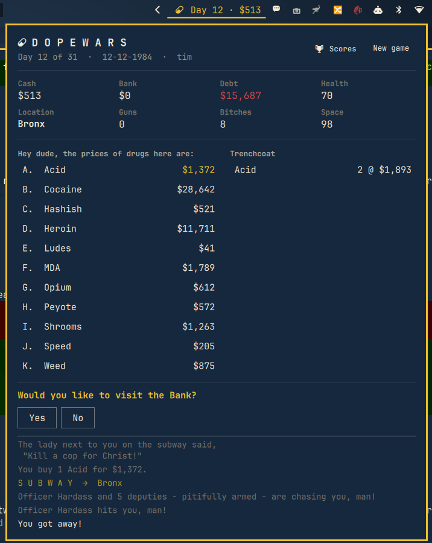

# Dopewars for the Omarchy bar

The classic **dopewars** (John E. Dell's 1984 *Drug Wars*, as kept alive by Ben
Webb's dopewars) as an Omarchy shell plugin. The whole single-player game lives
in a bar panel: buy low, sell high, dodge the cops, and pay off the Loan Shark
before your month is up. The game is saved after every move, so you can close
the panel, reboot, and take your next turn whenever you feel like it.

<p align="center">
  
</p>

## What's in it

Everything single-player dopewars 1.6.2 does, with the same numbers:

- The eight New York locations, twelve drugs, four guns and three cops
  (Officer Hardass, Officer Bob, Agent Smith) with their real prices, ranges,
  police presence and combat stats.
- The same turn: jet, 10% loan interest and 5% bank interest, the random
  events (bitch and gun offers, muggings, friends, police dogs, dead dudes,
  brownies, paraquat, "You stopped to smoke a Djarum"), the subway sayings and
  songs, the cheap and expensive price events.
- Cop fights with the original ratings, armour, deputies, loot, escalation and
  the doctor offer afterwards. Cops shoot first, then you alternate, like the
  original single-player game.
- The Loan Shark and the Bank in the Bronx, Dan's House of Guns and the pub in
  the Ghetto.
- 31 days, `Cash + Bank - Debt` as the score, an 18-entry high score table
  with `(R.I.P.)` for the dead.

Not included: multiplayer, networking, spies, tip-offs and AI players. The
"give errand" menu is gone too, since sacking a bitch is all that's left of it
in single player.

## Install

```bash
git clone https://github.com/ninepointlabs/omarchy-dopewars ~/Projects/omarchy-dopewars
cd ~/Projects/omarchy-dopewars
./install.sh            # copies into ~/.config/omarchy/plugins/ninepointlabs.dopewars and enables it
```

`install.sh right` puts the chip in the right section of the bar (the
default); use `left` or `center` if you prefer. Move it later with
`omarchy bar move ninepointlabs.dopewars --section center`.

Or straight from the marketplace: `omarchy plugin add https://github.com/ninepointlabs/omarchy-dopewars --enable`.

There are no dependencies beyond Omarchy itself: no packages, no network,
no background processes. `install.sh` only copies files into
`~/.config/omarchy/plugins/`; nothing runs as root.

## Remove

```bash
omarchy plugin remove ninepointlabs.dopewars
rm -rf ~/.local/state/omarchy-dopewars      # optional: the save and high scores
```

## Playing

Click the pill in the bar. The panel is the old curses screen rearranged:
stats on top, the drugs on sale here and your trenchcoat side by side, the
prompt line, then the message area.

- Click a drug (either list) to trade it. Type an amount or leave it blank
  for the maximum, then **Buy**, **Sell** or **Drop**. Enter buys when the
  drug is on sale here, otherwise sells.
- **Jet** lists the eight locations; click one or press its number. A day
  passes, interest is charged, and whatever the subway throws at you happens
  before you see the new prices.
- Questions take **y** / **n**. Fights take **f** (or **s** to stand when
  unarmed) and **r** to run; **d** or Enter deals drugs again afterwards.
- In a shop, Escape leaves. In the street, Escape closes the panel.
- **Scores** shows the high score table (also the `L>ist` key: `l` or →).
- **Quit** ends the game early and takes your score. **New game** abandons
  the current one.
- **About**: the 󰋽 button at the top right of the panel (or the `about` IPC
  call below) shows the version, the licence (readable in place), the credit
  to the original dopewars, what the game does with your data, and the
  support address, [help@ninepointlabs.com](mailto:help@ninepointlabs.com),
  with *Email*, *Copy* and *Copy version details* buttons. Back or Escape
  returns to the game.

The bar chip shows the day and your cash, and turns accent-coloured while the
game is waiting on you for something (a cop, a question, a shop).

## Settings

In `~/.config/omarchy/shell.json`, on the widget's entry:

| key          | default | meaning                                            |
|--------------|---------|----------------------------------------------------|
| `playerName` | `""`    | Name pre-filled on the new game screen (else `$USER`) |
| `showStatus` | `true`  | Show "Day N · $cash" next to the pill in the bar   |

## Security notes

- The plugin makes no network connections and runs no shell commands. The
  only subprocess is `mkdir -p` for its own state directory, called with an
  argument list. The About page's *Email* button hands a `mailto:` link to
  your desktop's mail app, and only when you click it.
- The save file is the only input it trusts from disk, and it doesn't
  trust it much: every field is type- and range-checked on load and a bad
  file is discarded with a warning rather than crashing the shell.
- Every piece of text in the panel is rendered as plain text, including the
  player name and anything read back from the save.
- It never edits anything outside `~/.local/state/omarchy-dopewars/`; the
  bar entry in `shell.json` is managed by Omarchy's own plugin commands.

## Where things live

- Save file and high scores: `~/.local/state/omarchy-dopewars/save.json`.
  Delete it to wipe everything.
- `Game.js` is the whole game engine, a straight transcription of the C
  server logic. `Service.qml` owns the state and the save file, `Panel.qml`
  is the screen, `BarWidget.qml` is the chip. `AboutView.qml` and
  `About.js` are the About page.
- `node test/play.js` plays a few thousand random games and checks the
  bookkeeping invariants after every action.
- `node test/about.js` checks the About page's facts against the repo and
  that the plugin still makes no network connections.

## IPC

```bash
omarchy-shell shell summon ninepointlabs.dopewars '{}'   # open
omarchy-shell shell hide ninepointlabs.dopewars           # close
qs -p /usr/share/omarchy/shell ipc call ninepointlabs.dopewars about    # open on the About page
qs -p /usr/share/omarchy/shell ipc call ninepointlabs.dopewars status
```

## Licence

GPL-2.0-only, like dopewars itself, whose data tables, rules and messages
this reproduces. dopewars is Copyright (C) Ben Webb 1998–2022.
